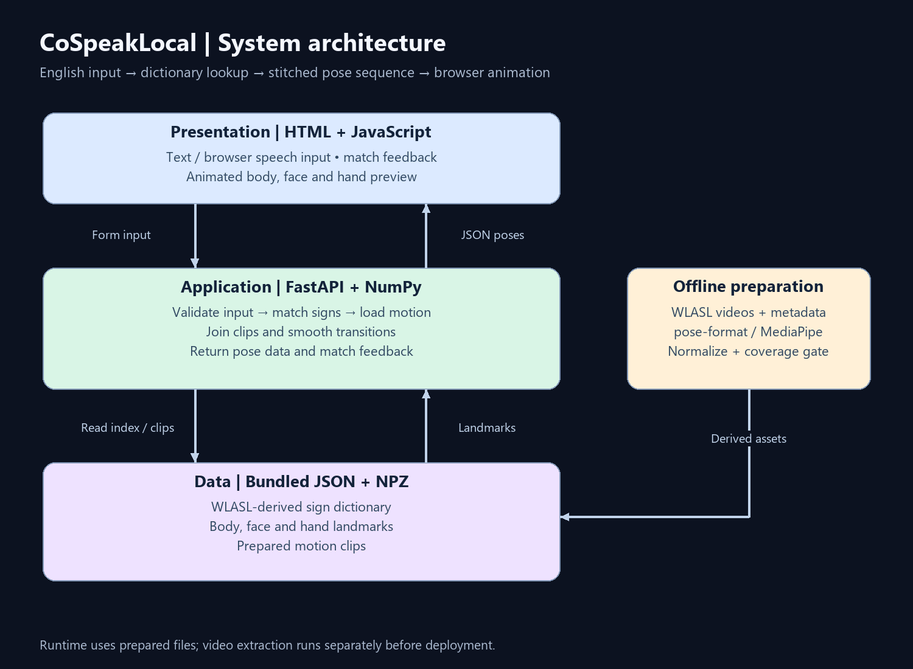
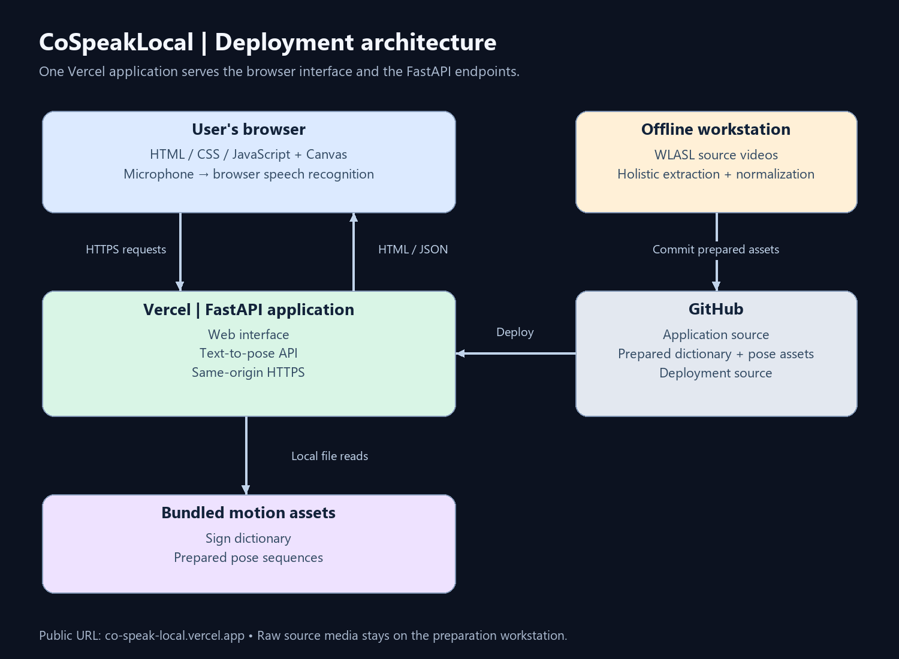

# Software Architecture — CoSpeakLocal

## 1. Project Overview

**Project name:** CoSpeakLocal  
**Purpose:** Convert supported typed or spoken English into animated isolated ASL sign sequences for learning and demonstration.  
**Architecture style:** Client-server web application with a file-based motion dictionary and a separate offline data-preparation pipeline.

### Main features

- Enter English text or use browser speech input.
- Match words and phrases against a WLASL-derived sign dictionary.
- Join motion clips with interpolated transitions and temporal smoothing.
- Display body, face, and hand landmarks on a browser canvas.
- Show matched signs, skipped function words, and unsupported vocabulary.

## 2. Technology Stack

| Layer | Technology | Responsibility |
| --- | --- | --- |
| Frontend | HTML, CSS, vanilla JavaScript, Canvas 2D | Input, match feedback, and animated pose preview |
| Browser speech | Web Speech API, where supported | Convert microphone input into English text |
| Backend | Python, FastAPI, NumPy | Validate input, retrieve clips, stitch motion, return JSON |
| Storage | JSON index and compressed NumPy `.npz` files | Store gloss metadata and landmark sequences |
| Offline extraction | OpenCV, pose-format, MediaPipe Holistic | Extract and normalize body, face, and hand landmarks |
| Optional local speech | faster-whisper | Transcribe uploaded audio |
| Hosting | Vercel | Serve the web interface and FastAPI application |
| Local server | Uvicorn | Run the application during development |
| Version control | GitHub | Track source code and derived motion assets |

There is no database server, account system, or authentication service in the current implementation.

## 3. System Architecture

The system has three main layers:

1. **Presentation:** Collects English input and displays animated sign motion.
2. **Application:** Validates input, matches dictionary entries, and joins motion clips into a smooth sequence.
3. **Data:** Stores the sign dictionary and prepared pose clips in local files.

The backend returns pose data as JSON. The browser renders the body, face, and hands using Canvas.

A separate offline pipeline processes WLASL videos, extracts and normalizes landmarks, checks tracking quality, and prepares the dictionary before deployment.

### Communication between components

- Browser → FastAPI: same-origin HTTPS requests with form fields or an audio upload.
- FastAPI → bundled data: local file reads, with no database connection.
- FastAPI → browser: JSON containing frames, FPS, matched clips, and unknown words.
- Offline preparation → deployment bundle: derived `.npz` files, JSON index, and manifest.

## 4. Main Application Flows

### 4.1 Text-to-pose flow

1. The user enters English and selects **Generate motion**.
2. JavaScript submits the `text` field to `POST /api/text-to-pose`.
3. FastAPI rejects empty or oversized input.
4. The dictionary matcher selects supported signs and records unknown or skipped words.
5. The server loads the selected clips, trims boundaries, interpolates transitions, and smooths the sequence.
6. The server returns pose frames and match information.
7. The browser fits the sequence to the canvas and plays it at the returned FPS.

### 4.2 Speech-to-pose flow

1. The user grants microphone access and speaks.
2. The browser's speech-recognition implementation produces an English transcript.
3. The interface submits that transcript through the text-to-pose flow.

The optional local API accepts an audio file at `POST /api/speech-to-pose`, transcribes it with faster-whisper, and invokes the same generation function. It returns `503` when that dependency is unavailable. Browser speech processing may use the browser vendor's service.

### 4.3 UI navigation flow

`Text / microphone / example phrase → Generate motion → Pose preview + match feedback`

The interface is a single page.

## 5. Data Design

### Dictionary index: `demo_data/asl_dictionary.json`

| Field | Type | Description |
| --- | --- | --- |
| `format` | String | Dictionary format identifier |
| `entries` | Array | Available sign records |
| `gloss` | String | Canonical English label for an isolated sign |
| `clip_id` | String | Identifier connecting the entry to a motion clip |
| `path` | String | Location of the corresponding motion clip |
| `fps` | Number | Clip playback rate |
| `source` | String | Dataset provenance |
| `quality` | Object | Body and hand detection rates |

The fields from `gloss` onward belong to each entry. Optional provenance fields can include a signer or video identifier.

### Motion clip: `.npz`

| Field | Representation | Description |
| --- | --- | --- |
| `poses` | Numeric array | Landmark coordinates for every frame |
| `meta` | JSON string | Clip ID, text, FPS, source, speaker, and quality metadata |

Motion clips contain body, face, and hand landmarks. The deployment stores prepared pose data rather than source video or audio.

**Relationship:** Each dictionary entry references one isolated-sign clip; a generation request can concatenate several clips.

## 6. API Design

| Method | Endpoint | Purpose | Request |
| --- | --- | --- | --- |
| `GET` | `/` | Serve the web interface | None |
| `GET` | `/api/health` | Report runtime, vocabulary count, and speech availability | None |
| `POST` | `/api/text-to-pose` | Generate a pose sequence from English | Form field `text` |
| `POST` | `/api/speech-to-pose` | Transcribe uploaded audio and generate poses | Multipart file field `file` |
| `GET` | `/api/docs` | Interactive FastAPI API documentation | None |

These endpoints do not require login.

Generation responses include pose frames, playback information, matched signs, and unknown words. Audio requests also return the transcript.

## 7. Security and Error Handling

- Hosted requests use HTTPS.
- The backend validates text and limits request length.
- Empty text returns `400`; oversized input returns `413`.
- Missing dictionary data or unavailable server-side transcription returns `503`.
- FastAPI validates required form fields and file parameters.
- Unknown vocabulary appears in the response and interface.
- Motion files are loaded without enabling pickle deserialization.
- Uploaded audio is temporarily stored and removed after processing.
- Browser microphone access depends on user permission.
- Authentication, application-level rate limiting, and explicit audio-upload size limits are not currently implemented.

## 8. Deployment Architecture

**Deployment status:** Deployed at [co-speak-local.vercel.app](https://co-speak-local.vercel.app/).

- **Browser:** Loads the interface, collects English input, and renders pose frames.
- **Vercel:** Hosts the web interface and FastAPI endpoints on the same origin.
- **Bundled files:** Provide the sign dictionary and prepared motion clips to the backend.
- **Offline workstation:** Processes source videos and prepares deployment artifacts.
- **GitHub:** Stores application code and derived assets for the deployment workflow.

The extraction dependencies and source-video corpus stay outside the hosted runtime. Optional local transcription runs with faster-whisper installed. The current browser microphone flow uses browser speech recognition.

Environment variables configure the dictionary location and request/response limits.

## 9. Architecture Decisions and Trade-offs

| Decision | Reason | Trade-off |
| --- | --- | --- |
| Vanilla JavaScript and Canvas | Direct control over pose rendering with minimal frontend tooling | Rendering and interaction logic are maintained manually |
| Bundled JSON and NPZ data | Simple, portable reads without a database service | Vocabulary growth increases deployment size |
| Offline landmark extraction | Keep expensive video processing out of API requests | Adding signs requires preprocessing and redeployment |
| Exact gloss and alias matching | Predictable correspondence with known motion clips | Unsupported paraphrases require explicit expansion |
| Boundary interpolation and smoothing | Reduce discontinuities and tracker jitter | May alter motion details; does not model linguistic transitions |
| Browser speech recognition | Avoid a hosted transcription model | Availability and processing depend on the browser |

## 10. Limitations and Future Improvements

**Current limitations**

- Available vocabulary is limited to the prepared dictionary and supported aliases.
- Concatenation does not implement continuous-ASL grammar or contextual facial expression generation.
- Source signers and camera conditions vary; automated tracking coverage does not establish linguistic correctness.
- Long sequences are limited for response size, which can affect playback timing.
- Semantic embeddings, typo-tolerant retrieval, and a searchable vocabulary interface are planned.

**Future improvements**

- Add contextual retrieval with evaluated thresholds for approximate matches.
- Expand vocabulary and introduce visual and linguistic review of clips.
- Improve transition quality, duration preservation, and missing-landmark handling.
- Add vocabulary discovery and examples.

## 11. Architecture Change Log

| Date | Change | Reason |
| --- | --- | --- |
| 2026-10-20 | Documented the application layers, preparation pipeline, and deployment | Provide a general overview of the implemented architecture |
